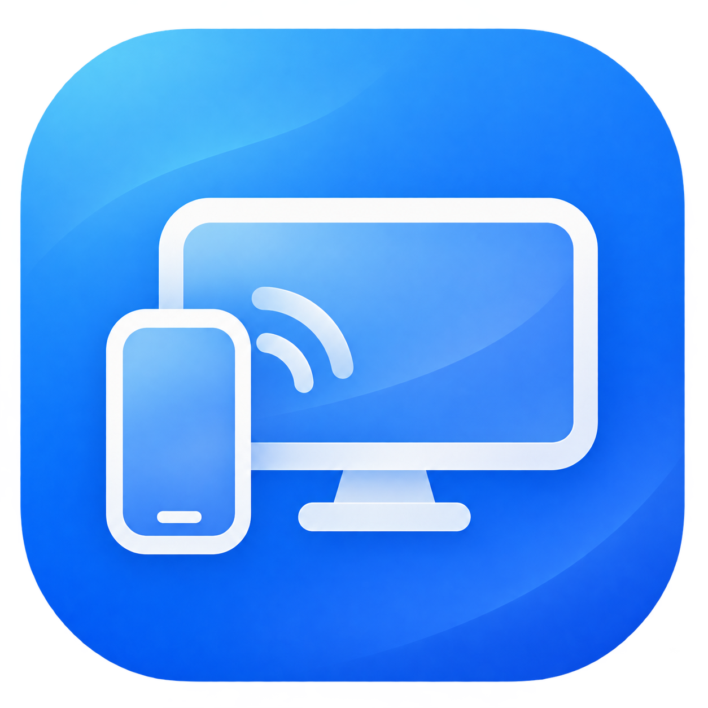
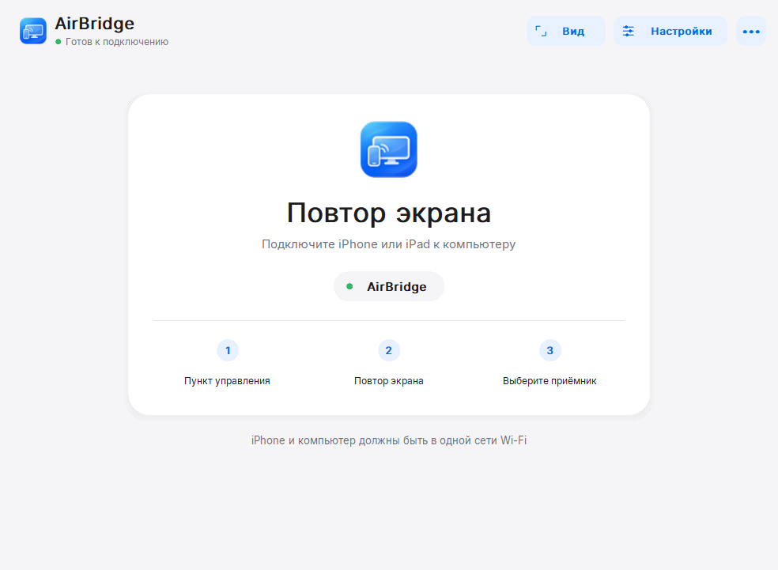

# AirBridge — iPhone Screen Mirroring for Windows

**Mirror your iPhone or iPad screen and audio to a Windows PC over Wi-Fi.** AirBridge is a free, open-source AirPlay receiver. Connect using the built-in **Screen Mirroring** menu — no app installation on your phone is needed.

**[Download for Windows](https://github.com/PH4N7OMx/AirBridge/releases)** · [Русский](docs/README.ru.md)

**Windows 10 (1809+) / Windows 11 · x64 · Preview**

## Get started

1. Download the **Setup EXE** or **Portable ZIP** from [Releases](https://github.com/PH4N7OMx/AirBridge/releases).
2. Run the installer, or extract the entire portable ZIP and open `AirBridge.exe`. Keep the included DLLs beside it.
3. Connect your iPhone/iPad and PC to the same local network.
4. On your phone, open **Control Center → Screen Mirroring → AirBridge**.

A PC connected by Ethernet also works when it shares the phone's local network.

## Watching and controls

Use fullscreen, rotate the picture or adjust its scaling from **View**. Change resolution and the frame-rate limit (up to 60 FPS) in **Settings**, then reconnect to apply them.

| Key | Action |
| --- | --- |
| **F11** | Toggle fullscreen |
| **Esc** | Leave fullscreen / close settings |
| **R** | Rotate the picture |

## Troubleshooting

**AirBridge does not appear on your phone**

Check that both devices are on the same network. Guest Wi-Fi, a VPN or device isolation can block the connection. On a trusted Private network, use **••• → Allow local network access…**, approve the Windows prompt and try again.

**The picture stutters or disconnects**

Lower the resolution or FPS in **Settings**, save and reconnect. If needed, try toggling GPU acceleration or HEVC.

**A video is black or only sound plays**

Use **Control Center → Screen Mirroring** instead of an app's audio casting button. Protected video may not be displayed.

This is a preview; compatibility and playback quality can vary by device and network. To report a problem, open an issue with your Windows/iOS versions, device model and steps to reproduce it. Review logs for personal information before attaching them.

[Developer guide](source/rust/README.md) · [GPL-3.0-or-later](LICENSE) · [Third-party notices](THIRD_PARTY_NOTICES_RUST.md)
