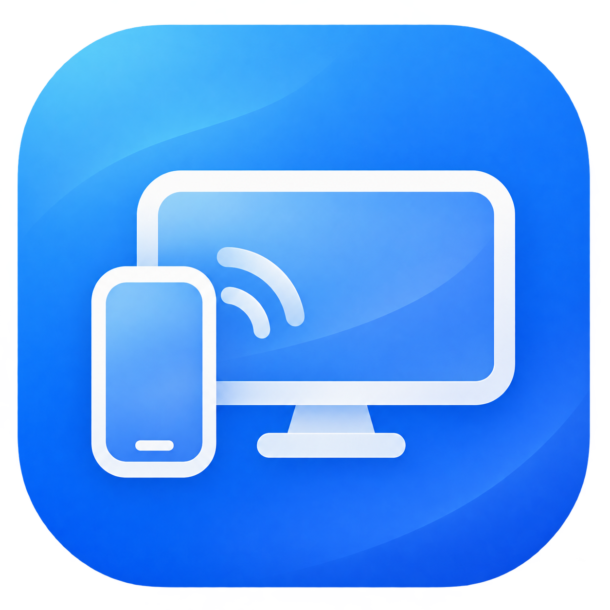
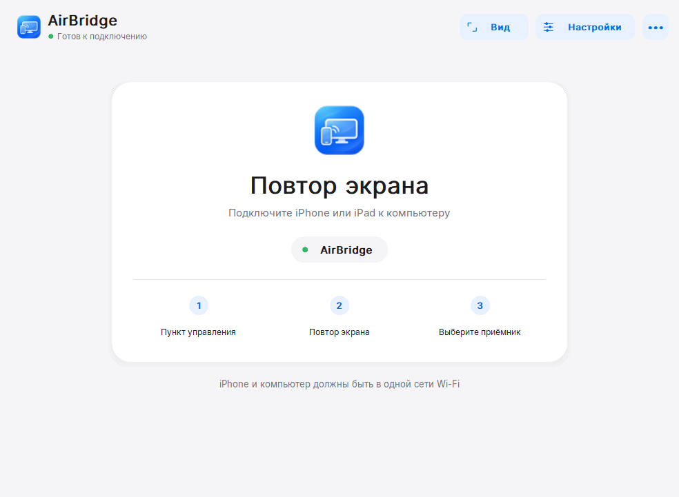

# AirBridge — экран iPhone на ПК с Windows

**Транслируйте экран и звук iPhone или iPad на компьютер по Wi-Fi.** AirBridge — бесплатный приёмник AirPlay с открытым исходным кодом. Подключение через встроенный «Повтор экрана» — устанавливать приложение на телефон не нужно.

**[Скачать для Windows](https://github.com/PH4N7OMx/AirBridge/releases)** · [English](../README.md)

**Windows 10 (1809+) / Windows 11 · x64 · Предварительная версия**

## Как подключиться

1. Скачайте **Setup EXE** или **Portable ZIP** в разделе [Releases](https://github.com/PH4N7OMx/AirBridge/releases).
2. Запустите установщик или распакуйте весь portable-архив и откройте `AirBridge.exe`. DLL из архива должны оставаться рядом с программой.
3. Подключите iPhone/iPad и ПК к одной локальной сети.
4. На телефоне откройте **Пункт управления → Повтор экрана → AirBridge**.

ПК может быть подключён кабелем Ethernet, если он находится в одной локальной сети с телефоном.

## Просмотр и управление

В меню **Вид** доступны полный экран, поворот и масштабирование. Разрешение и ограничение частоты кадров (до 60 FPS) можно изменить в **Настройках**, затем переподключиться для их применения.

| Клавиша | Действие |
| --- | --- |
| **F11** | Включить или выключить полный экран |
| **Esc** | Выйти из полного экрана / закрыть настройки |
| **R** | Повернуть изображение |

## Если что-то не работает

**AirBridge не появляется на телефоне**

Проверьте, что оба устройства в одной сети. Гостевой Wi-Fi, VPN или изоляция устройств могут мешать подключению. В доверенной частной сети выберите **••• → Доступ в локальной сети…**, подтвердите запрос Windows и попробуйте снова.

**Изображение тормозит или соединение обрывается**

Уменьшите разрешение или FPS в **Настройках**, сохраните и переподключитесь. При необходимости попробуйте включить или отключить ускорение GPU либо HEVC.

**Вместо видео чёрный экран или идёт только звук**

Используйте **Пункт управления → Повтор экрана**, а не кнопку передачи звука в отдельном приложении. Защищённое видео может не отображаться.

Это предварительная версия: совместимость и качество воспроизведения зависят от устройства и сети. Сообщая об ошибке через Issues, укажите версии Windows/iOS, модель устройства и шаги воспроизведения. Перед отправкой журнала проверьте его на личные данные.

[Для разработчиков](../source/rust/README.md) · [GPL-3.0-or-later](../LICENSE) · [Сторонние компоненты](../THIRD_PARTY_NOTICES_RUST.md)
